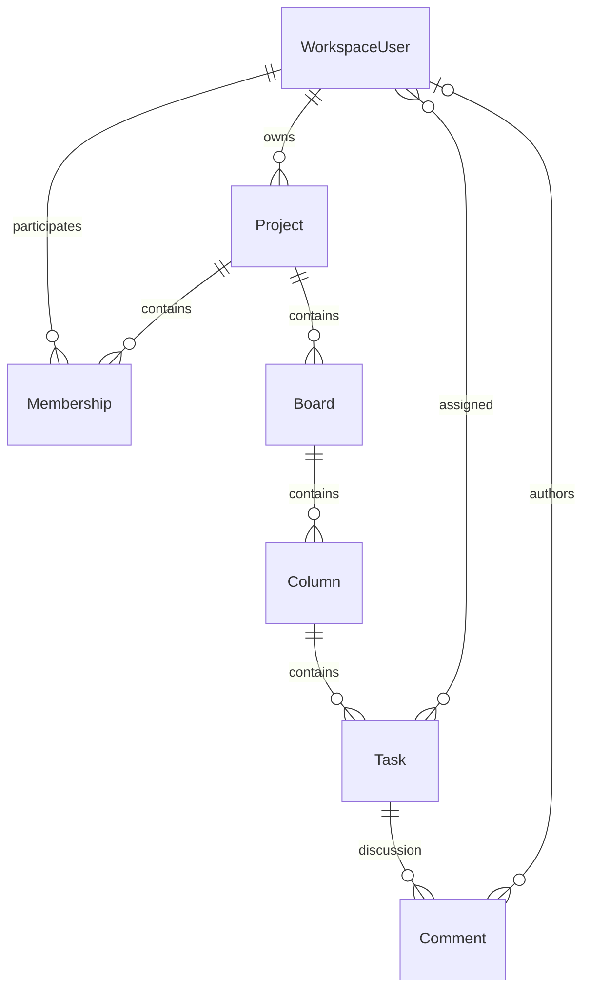

# Общие модели данных — BE-11

Источник: backend/tasks/models.py, serializers.py и api.py. Срез main e6a589c. Изменения схемы и API в этой задаче не выполняются.

## Связи

Membership уникален по (user, project); доступ дают владелец либо подтверждённое участие. Профессия role не равна access_role. Task связан с Project через Column и Board. Удаление проекта каскадно удаляет его задачи и комментарии; удаление автора оставляет nullable ссылку creator/user.

## User (WorkspaceUser)

Обязательность ниже относится к хранению в модели, не к наличию поля в POST. Состав запросов задан в api.md.

| Поле | Тип / связь | Обязательность | Кто задаёт / назначение |
|---|---|---|---|
| id | BigAutoField | может быть пустым | сервер: первичный ключ; ID |
| password | CharField(128) | да | сервер авторизации; не публиковать в API; пароль |
| last_login | DateTimeField | может быть NULL | сервер авторизации; не публиковать в API; последний вход |
| is_superuser | BooleanField | да | администратор / сервер; не произвольное поле регистрации; статус суперпользователя |
| username | CharField(150) | да | клиент через разрешённый метод; сервер валидирует; имя пользователя |
| first_name | CharField(150) | может быть пустым | клиент через разрешённый метод; сервер валидирует; имя |
| last_name | CharField(150) | может быть пустым | клиент через разрешённый метод; сервер валидирует; фамилия |
| email | CharField(254) | может быть пустым | клиент через разрешённый метод; сервер валидирует; адрес электронной почты |
| is_staff | BooleanField | да | администратор / сервер; не произвольное поле регистрации; статус персонала |
| is_active | BooleanField | да | администратор / сервер; не произвольное поле регистрации; активный |
| date_joined | DateTimeField | да | сервер авторизации; не публиковать в API; дата регистрации |
| registration_pending | BooleanField | да | сервер авторизации; не публиковать в API; registration pending |
| account_type | CharField(16) | да | администратор / сервер; не произвольное поле регистрации; значения: student, teacher, staff; account type |
| bio | TextField(500) | может быть пустым | клиент через разрешённый метод; сервер валидирует; О себе |
| otp_attempts | PositiveSmallIntegerField | да | сервер авторизации; не публиковать в API; otp attempts |
| otp_code | CharField(128) | может быть NULL | сервер авторизации; не публиковать в API; Одноразовый код |
| otp_expiry | DateTimeField | может быть NULL | сервер авторизации; не публиковать в API; Время действия кода |
| groups | ManyToManyField → Group | может быть пустым | администратор / сервер; не произвольное поле регистрации; Группы |
| user_permissions | ManyToManyField → Permission | может быть пустым | администратор / сервер; не произвольное поле регистрации; Права доступа |

## Project

Обязательность ниже относится к хранению в модели, не к наличию поля в POST. Состав запросов задан в api.md.

| Поле | Тип / связь | Обязательность | Кто задаёт / назначение |
|---|---|---|---|
| id | BigAutoField | может быть пустым | сервер: первичный ключ; ID |
| name | CharField(255) | да | клиент через разрешённый метод; сервер валидирует; Название проекта |
| description | TextField | может быть пустым | клиент через разрешённый метод; сервер валидирует; Описание |
| created_at | DateTimeField | может быть пустым | сервер: время; created at |
| owner | ForeignKey → WorkspaceUser | да | сервер операции: связь, доступ или этап жизненного цикла; Владелец |
| members | ManyToManyField → WorkspaceUser | может быть пустым | клиент через разрешённый метод; сервер валидирует; Участники |

## Membership

Обязательность ниже относится к хранению в модели, не к наличию поля в POST. Состав запросов задан в api.md.

| Поле | Тип / связь | Обязательность | Кто задаёт / назначение |
|---|---|---|---|
| id | BigAutoField | может быть пустым | сервер: первичный ключ; ID |
| user | ForeignKey → WorkspaceUser | да | сервер операции: связь, доступ или этап жизненного цикла; Пользователь |
| project | ForeignKey → Project | да | сервер операции: связь, доступ или этап жизненного цикла; Проект |
| role | CharField(20) | да | клиент через разрешённый метод; сервер валидирует; значения: developer, designer, analyst, security, tester, other; Роль в команде |
| developer_specialization | CharField(20) | может быть пустым | клиент через разрешённый метод; сервер валидирует; значения: backend, frontend, ios, android; Направление разработки |
| custom_role | CharField(100) | может быть пустым | клиент через разрешённый метод; сервер валидирует; Своя роль |
| access_role | CharField(16) | да | сервер операции: связь, доступ или этап жизненного цикла; значения: member, teacher, coordinator; access role |
| is_confirmed | BooleanField | да | сервер операции: связь, доступ или этап жизненного цикла; Подтверждено вступление |
| joined_at | DateTimeField | да | клиент через разрешённый метод; сервер валидирует; Дата вступления |

## Task

Обязательность ниже относится к хранению в модели, не к наличию поля в POST. Состав запросов задан в api.md.

| Поле | Тип / связь | Обязательность | Кто задаёт / назначение |
|---|---|---|---|
| id | BigAutoField | может быть пустым | сервер: первичный ключ; ID |
| column | ForeignKey → Column | да | сервер операции: связь, доступ или этап жизненного цикла; Колонка/Статус |
| tag | CharField(60) | может быть пустым | клиент через разрешённый метод; сервер валидирует; tag |
| result_url | CharField(2000) | может быть пустым | клиент через разрешённый метод; сервер валидирует; result url |
| submitted_at | DateTimeField | может быть NULL | сервер операции: связь, доступ или этап жизненного цикла; submitted at |
| accepted_at | DateTimeField | может быть NULL | сервер операции: связь, доступ или этап жизненного цикла; accepted at |
| title | CharField(255) | да | клиент через разрешённый метод; сервер валидирует; Заголовок задачи |
| description | TextField | может быть пустым | клиент через разрешённый метод; сервер валидирует; Описание задачи |
| creator | ForeignKey → WorkspaceUser | может быть NULL | сервер операции: связь, доступ или этап жизненного цикла; Создатель |
| due_date | DateTimeField | может быть NULL | клиент через разрешённый метод; сервер валидирует; Срок выполнения |
| created_at | DateTimeField | может быть пустым | сервер: время; created at |
| updated_at | DateTimeField | может быть пустым | сервер: время; updated at |
| position | PositiveIntegerField | да | клиент через разрешённый метод; сервер валидирует; Позиция в колонке |
| assignees | ManyToManyField → WorkspaceUser | может быть пустым | клиент через разрешённый метод; сервер валидирует; Исполнители |

## Comment

Обязательность ниже относится к хранению в модели, не к наличию поля в POST. Состав запросов задан в api.md.

| Поле | Тип / связь | Обязательность | Кто задаёт / назначение |
|---|---|---|---|
| id | BigAutoField | может быть пустым | сервер: первичный ключ; ID |
| task | ForeignKey → Task | да | сервер операции: связь, доступ или этап жизненного цикла; task |
| user | ForeignKey → WorkspaceUser | может быть NULL | сервер операции: связь, доступ или этап жизненного цикла; user |
| text | TextField(2000) | да | клиент через разрешённый метод; сервер валидирует; text |
| created_at | DateTimeField | может быть пустым | сервер: время; created at |

## Отображение в JSON

| Понятие задачи | Модель | Реальный JSON |
|---|---|---|
| заголовок | title | title, строка до 255, обязателен при создании |
| описание | description | description, строка до 10000 в API, пустая разрешена |
| assignee_id | assignees M2M | assigneeId, строковый ID; assigneeIds при чтении всех назначений |
| due_at | due_date | deadlineAt, ISO 8601 со смещением либо пустая строка |
| status | column.workflow_status | todo, in_progress, in_review, done либо column_ID для дополнительной колонки |

Поля assignee_id/due_at из постановки — понятия, а не новые ключи API. Не отправлять их вместо assigneeId/deadlineAt. Ручное создание требует исполнителя, помощник может создать без назначения. В JSON отсутствующие ссылки/даты часто представлены "", а не null. ID задач и проектов строковые, но коллеги возвращают числовые id/userId/projectIds — сохраняем фактический контракт.

User snapshot: id, name, email, bio, color, kind, scopeProjectIds. Пароль, OTP и служебные права не входят. Membership snapshot: projectId, userId, role (leader/teacher/member), profession, specialization, customRole. Эти role и profession не следует путать с ORM role/access_role.
