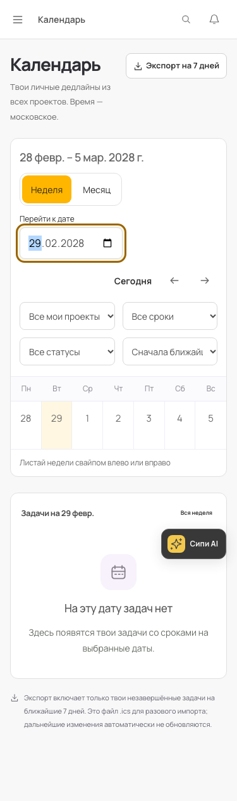
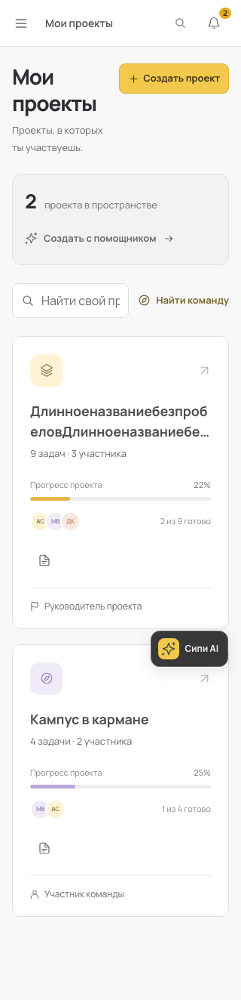
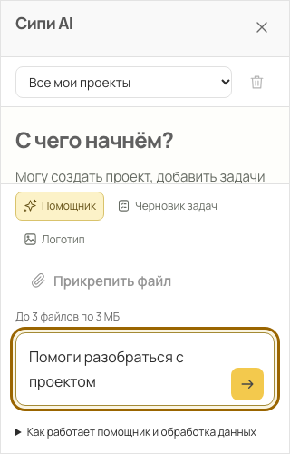
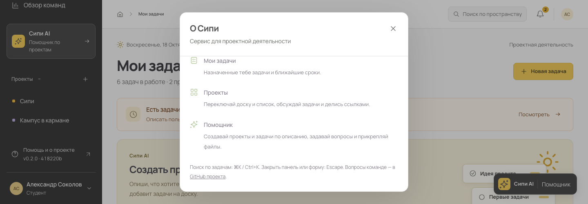

# Проверка отчётов безопасности и открытых задач — 23 ноября 2026

Основа: `main` на коммите `418220b` (включая PR #138 и #139). Исправления собраны в одной ветке. Рабочая база, реальные письма, файлы пользователей и настройки облака не изменялись.

Источники: пять переданных отчётов и 38 открытых issues Team_Control. Доска Projects без авторизации возвращала 404; скрытые черновики карточек не проверены. Дата старого отчёта API и актуальный код различаются: найденное в ноябрьском отчёте не считается автоматически действующей уязвимостью.

## Результат по отчётам

| Источник / замечание | Проверка и изменение |
| --- | --- |
| «Отчет проверки_допроверен»: потеря `Allow` в 405 | Next-прокси сохраняет `Allow`, `Retry-After`, заголовки защиты и отдельные cookies. Тесты 405/429 проверяют также отсутствие передачи произвольного внутреннего заголовка. |
| Отсутствие `X-Content-Type-Options` / `X-Frame-Options` | Общие ответы Next получают `nosniff` и `DENY`; ответы Django сохраняют свои заголовки через прокси. HTML проверен браузерными тестами. |
| Некорректный код тратит попытку; выход без тела; старая ссылка на результат | Уже исправлено в актуальном main. Существующие серверные тесты проверены повторно; браузерный цикл задачи проверяет сброс результата после возврата в работу. |
| «Отчёт модели и данные» | Это описание схемы и наблюдений, а не подтверждённый набор новых уязвимостей. Проверены действующие проверки доступа к проектам, задачам, истории, файлам и ИИ. Нет основания изменять схему только из-за отсутствия у проверяющих миграций. |
| «Отчёт пароли» | Сохранены Django-хеширование/валидаторы, OTP и обязательная проверка почты. Регистрация, восстановление и вход проверяются без обхода кода. Общие DB-лимиты уже есть в main. Решение о раскрытии занятого email в регистрации остаётся в #53. |
| «Отчет AI ассистент»: вместо отказа показан Python tuple | Пользователь получает `APIError.message`, а не кортеж с кодом и HTTP-статусом. |
| ИИ заявляет, что удалил задачу, хотя данных не изменял | Типовые команды удаления/смены ролей получают серверное объяснение без вызова модели. Для всех ответов чата без выполненного инструмента сервер добавляет признак `readOnly`; интерфейс явно пишет «Данные проекта не изменены». Модель не может сама присвоить себе подтверждение изменения. |
| Смешанный запрос выполняется частично | Известные смешанные запросы с неподдерживаемыми действиями, а также команды создания нескольких проектов отклоняются целиком с объяснением. Полная поддержка произвольных многошаговых сценариев не заявляется. |
| Prompt injection / повторение / смена роли | Защита основана на серверных разрешениях и повторной проверке перед записью, а не на поиске слов. Контекст, история, изображение, подтверждение задач, повтор запроса и отзыв доступа покрыты тестами #56/#62. Простое текстовое правило — только защита от вводящего в заблуждение ответа. |
| «Отчет_Атака_Red_Team»: заранее созданный `/tmp/*.sock` | Сокет локального запуска перенесён в `~/.sipi-run` с правами 700. Проверяется владелец, тип и права каталога; symlink и общедоступный каталог отвергаются. Сокет имеет права 600. Это исправление локального запуска, а не утверждение о взломе Vercel. |

## Исправления интерфейса и проверки

| Issues | Изменение |
| --- | --- |
| #42 | В CI добавлены браузерные регрессии с изолированными данными и проверки локального запуска. При падении сохраняется диагностический артефакт. |
| #43 | Next.js и eslint-config-next обновлены с 16.4.3 до 16.4.6, lockfile обновлён; итоговый npm audit — 0 известных уязвимостей. |
| #89 | В календаре статус обозначается цветом и текстом; цвета совпадают со списком и маркерами доски; просрочка отдельно отмечается рамкой и словом. Завершённая задача не становится просроченной. Для пользовательского этапа есть нейтральное оформление и его название. |
| #90 | У окна помощи фиксирована шапка с кнопкой закрытия, прокручивается содержимое. |
| #91 | У составного поиска одна обводка фокуса на контейнере вместо двух вложенных. |
| #92 | Дополнительные пояснения помощника убраны в раскрываемую справку; информация о передаче выбранных файлов остаётся видимой. Высота панели учитывает visualViewport, компактный режим сохраняет ввод и отправку. |
| #94 | Выбор конкретной даты в календаре, согласованное переключение периода/списка и возврат к сегодня. Свайпы и переходы через границы месяцев/лет проверены. |
| #95 | Показ/скрытие пароля во входе, регистрации, восстановлении и смене email; значение и курсор сохраняются, форма не отправляется кнопкой показа. |
| #96 | Пустое направление — disabled-подсказка. Исправлена обнаруженная регрессия backend: собственное направление до 100 символов принимается, пробелы нормализуются. |
| #97 | Списки показывают по 20 задач с общим количеством и кнопкой «Показать ещё». Фильтры применяются ко всему набору до сокращения списка. |
| #98 | «Активные» содержит незавершённые личные задачи; завершённые остаются в своей вкладке. |
| #99 | Вместо условного МП взят официальный знак с [сайта университета](https://mospolytech.ru/local/templates/main/dist/img/logos/mospolytech-logo-white.png), сохранены пропорции и доступное название. |
| #105 | Список проектов в боковой панели сворачивается; есть `aria-expanded` и управление клавиатурой. |
| #106 | На заполненной странице убрана повторяющаяся карточка создания; повторный переход к команде в шапке заменён счётчиком. Основная вкладка «Команда» сохранена. |
| #107 | При открытии поиска видны доступные проекты без ввода; задачи появляются по запросу. Используются только данные разрешённого сервером snapshot. |
| #108 | Длинные названия карточек ограничены двумя строками и переносятся внутри блока; исходное имя не обрезается в данных. Полное описание доступно в паспорте проекта. |
| #116 | Проверено пересечение фильтров, а не объединение по ИЛИ. |
| #122 | Исправлены кортежи ошибок ИИ и базовые браузерные сообщения валидации полей: пустое значение, email/URL, короткий ввод, неверный формат. Ошибки API/провайдера не заменяются выдуманным успехом. |
| Дополнительный дефект | Второй и последующие исполнители учитываются в личных задачах, календаре, фильтрах, счётчиках и действиях; доступ к чужому проекту по-прежнему проверяется отдельно. |

## Границы результата и оставшиеся задачи

- **#88, #87, #121:** часть читаемости и адаптации исправлена; приложены кадры для 320, 375, 768 и 1440 px. Проверка настоящей iOS-клавиатуры, масштаба 200% и окончательная приёмка всего интерфейса остаются за повторным тестированием. Нельзя считать все критерии WCAG проверенными по нескольким скриншотам.
- **#104:** в карточке не указан конкретный некликабельный элемент. Проверены основные формы, переходы и цикл задачи; без точного воспроизведения произвольное «исправление» не добавлено.
- **#56/#62:** серверная матрица и конкурентный отзыв доступа проверены на PostgreSQL. Это не новая атака на рабочие аккаунты и не подтверждение поведения каждого ответа настоящего облачного LLM. После публикации нужен короткий приёмочный прогон безопасников на отдельном проекте.
- **#52:** общие лимиты уже реализованы. **#53:** лимиты тоже есть, но раскрытие занятого email при регистрации остаётся продуктовым решением; политика не менялась молча.
- **#109/#112:** удаление своих сообщений и паспорт уже присутствуют в main. Не дублировались незавершённые старые PR; добавлена защита паспорта от исчезнувшего после отзыва доступа проекта.
- **#101:** отдельная новая возможность аватара и существующий PR #127. Не включено несогласованное слияние чужого PR.
- **#16/#65/#133:** резервные копии/восстановление, фактическое облачное хранилище и доступ без VPN требуют проверки развёртывания и доступов. В main есть реализации database/S3 storage, но наличие настроенного bucket и рабочего бэкапа этим PR не подтверждается.
- **#57/#58:** отдельные Android-интеграции. Этот PR изменяет веб и Django, не содержит сборку и приёмку мобильного приложения.
- **#117–120:** исследования распознавания речи, новые сценарии ИИ и календарная синхронизация — новые функции, а не исправления обнаруженных дефектов. Не объявлены завершёнными.

## Проверки и воспроизведение

- Django: 396 тестов на PostgreSQL, без пропусков. SQLite: 396 тестов, четыре PostgreSQL-проверки пропущены штатно.
- Локальный запуск: 13 тестов, включая защищённый каталог, symlink, повторный запуск, остановку дочерних процессов и освобождение портов.
- `makemigrations --check --dry-run`: новых миграций не требуется.
- TypeScript, ESLint и production build Next.js 16.4.6.
- Браузерные регрессии: **30 passed** на production-сборке; после финального согласования цветов дополнительно пройден тест соответствия цветов календаря/списка и исключения завершённых задач из просроченных (31 сценарий суммарно); фиктивный snapshot для размеров/поиска/фильтров и отдельная локальная база Django для регистрации, OTP, восстановления, приглашений, задач и вложений.
- Исправлены ошибки старых тестов: чтение MIME-письма восстановления, слишком широкие селекторы паролей, ожидание `null` вместо пустой строки по текущему контракту, прямой `response.close()` внутри транзакционного теста скачивания. Проверки доступа и удаления файлов сохранены.

Скриншоты в `docs/evidence/backlog-*.png` содержат только вымышленные данные. Это локальная сборка на основе указанного выше коммита, не скриншоты уже опубликованного сайта.

